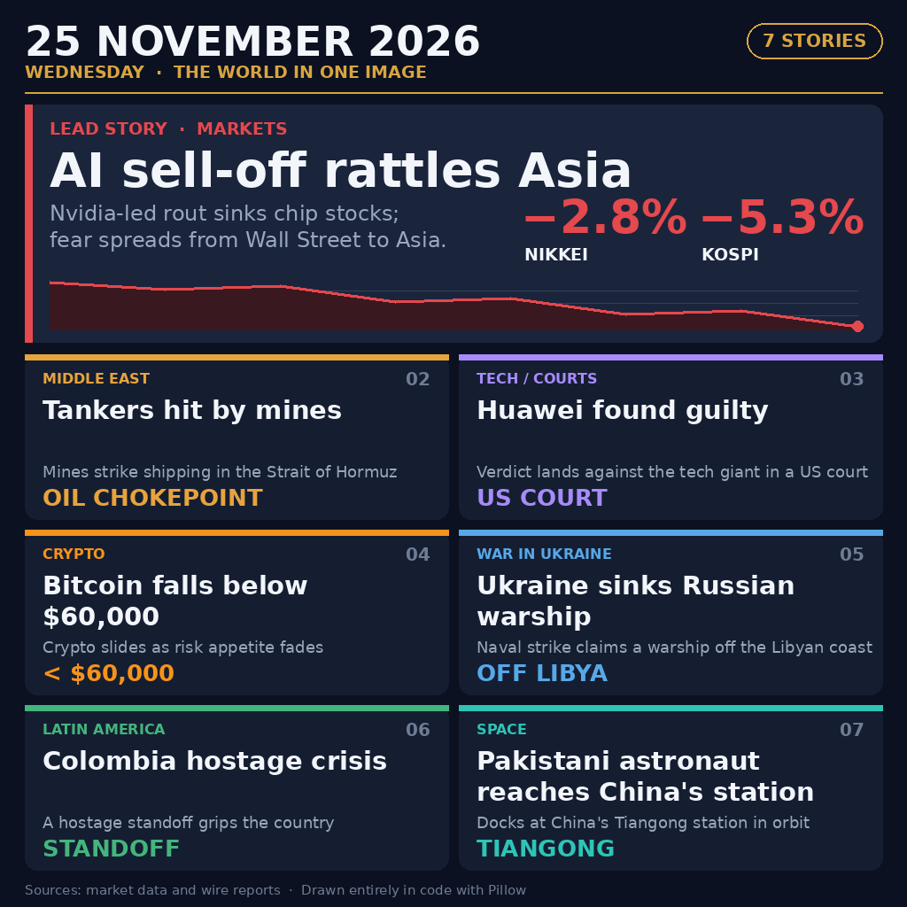

# news-image-20261125

[](https://make.fun/bounty/news-image-20261125?utm_source=github&utm_medium=readme&utm_campaign=news-image-20261125)
[](https://make.fun/bounty/news-image-20261125/leaderboard?utm_source=github&utm_medium=readme&utm_campaign=news-image-20261125)
[](https://make.fun/bounty/news-image-20261125?utm_source=github&utm_medium=readme&utm_campaign=news-image-20261125)

**Red Wednesday** — a hand-drawn 1024x1024 poster that sums up Wednesday 25 November 2026 in seven stories: the Nvidia-led AI sell-off that rattled Asia (Nikkei −2.8%, Kospi −5.3%), tankers hit by mines in the Strait of Hormuz, Huawei found guilty in a US court, Bitcoin falling below $60,000, Ukraine sinking a Russian warship off Libya, the Colombia hostage crisis, and a Pakistani astronaut reaching China's space station. Drawn entirely in code with Pillow — no photos, no network, no copied artwork.



## The seven stories

1. **AI sell-off rattles Asia** — Nvidia-led rout sinks chip stocks; fear spreads from Wall Street to Tokyo and Seoul. Nikkei −2.8%, Kospi −5.3%.
2. **Tankers hit by mines** — Mines strike shipping in the Strait of Hormuz, the world's key oil chokepoint.
3. **Huawei found guilty** — Verdict lands against the tech giant in a US court.
4. **Bitcoin falls below $60,000** — Crypto slides as risk appetite fades.
5. **Ukraine sinks Russian warship** — Naval strike claims a warship off the Libyan coast.
6. **Colombia hostage crisis** — A hostage standoff grips the country.
7. **Pakistani astronaut reaches China's station** — Docks at China's Tiangong station in orbit.

## How it is drawn

`draw_poster.py` (Python 3 + Pillow, standard DejaVu fonts) draws the whole poster: a lead panel for the market sell-off with its falling chart line and the two index numbers, then a 2×3 grid for the other six stories, each with its own accent colour, region tag, headline, detail line and key stat. Running it twice produces a byte-identical PNG (fixed fonts, fixed coordinates, no randomness, no timestamps).

```
python3 draw_poster.py   # writes entry.png (1024x1024)
```
